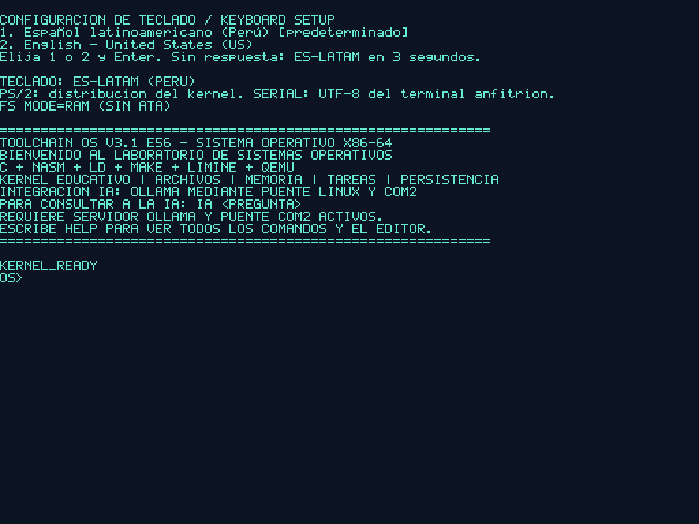
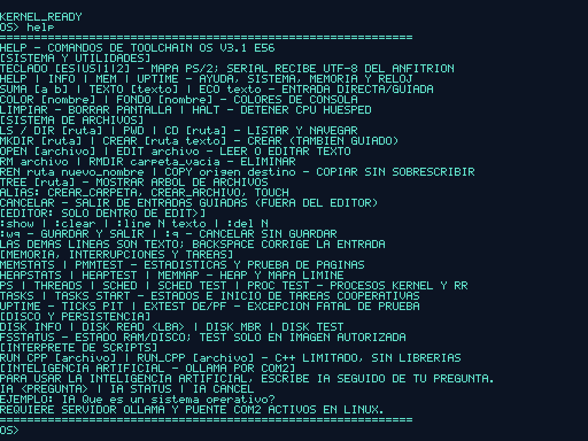
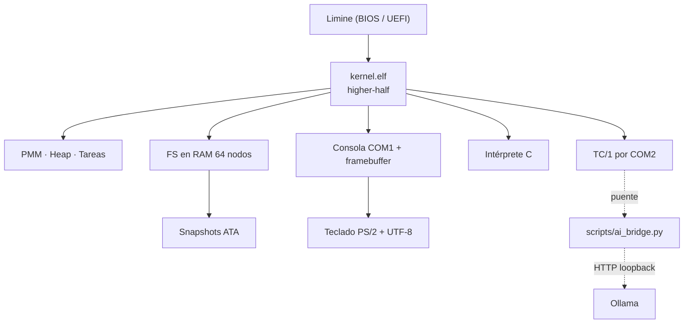

# Toolchain OS

**Un sistema operativo x86-64 escrito desde cero.** Kernel propio en C11 y NASM, sin
librería estándar: memoria física, heap, tareas con cambio de contexto, archivos que
sobreviven al reinicio, texto UTF-8 y un canal de conversación con una IA local.
Arranca en BIOS y UEFI desde una ISO híbrida y se ejecuta en QEMU.

<!-- Badge de CI: requiere el repositorio pantor400/ToolChainOS y la rama main. -->
[](https://github.com/pantor400/ToolChainOS/actions/workflows/ci.yml)
[](LICENSE)
[](#5-subsistemas)
[](#2-compilar-y-ejecutar)
[](artifacts/etapas56-20261029/results.json)
[](#2-compilar-y-ejecutar)



## Qué puedes hacer con él

| | |
|---|---|
| **Arrancar sin sistema anfitrión** | ISO híbrida BIOS/UEFI con Limine 8.x: sin GRUB, sin libc y sin dependencias en tiempo de ejecución |
| **Administrar su propia memoria** | PMM por bitmaps hasta 4 GiB y heap por arenas con división, fusión y alineación de 16 bytes |
| **Guardar archivos entre reinicios** | FS en RAM de 64 nodos con snapshots ATA alternados, generación y recuperación ante corrupción |
| **Ejecutar tareas concurrentes** | 16 PCB/TCB, pilas de 16 KiB con canario y Round Robin cooperativo con contexto en NASM |
| **Hablar UTF-8 de verdad** | Validación estricta, teclado ES-LATAM/US con teclas muertas y glifos españoles en framebuffer |
| **Trabajar en un escritorio** | GUI de tema claro a 1920x1080 (por defecto, con `make run FULLSCREEN=1` para pantalla completa) o 1280x800, con ventanas, dock, arrastre, repintado por zonas, puntero PS/2 sin retardo y reloj local en la barra |
| **Consultar el sistema y los archivos** | Ventana Sistema con CPU, núcleos, RAM, heap, tareas, red, ratón y uptime; ventana Archivos con navegación, apertura, creación, borrado y renombrado |
| **Conectar la máquina a la red** | Driver PCI RTL8139 con MAC, ARP, ping ICMP y DNS por UDP sobre la red de usuario de QEMU (IP fija 10.0.2.15/24) |
| **Cargar programas propios** | Cargador ELF64 de PIE estáticos con `host_api_t` v3 (editor y terminal incluidos en `apps/`) |
| **Conversar con una IA local** | Protocolo binario TC/1 por COM2 hacia Ollama, probado extremo a extremo con UTF-8 |

> **Estado:** 19 de 19 grupos automatizados PASSED, 0 FAILED, 0 BLOCKED, 0 SKIPPED.
> La evidencia reproducible está en
> [`artifacts/etapas56-20261029/`](artifacts/etapas56-20261029/) (`results.json` y los
> registros `*-final.log` de cada grupo).

| Dato | Valor |
|---|---|
| Arquitectura | x86-64, higher-half `0xffffffff80000000` |
| Arranque | Limine 8.x (BIOS y UEFI), ISO híbrida |
| Emulador de referencia | QEMU `qemu-system-x86_64`, máquina `q35`, 256 MiB, 2 vCPU, KVM automático (TCG si no hay `/dev/kvm`) |
| Tamaño del kernel | ~818 KiB ELF (`build/kernel.elf`), sin secciones RWX |
| Estado de validación | **19 de 19 grupos automatizados PASSED**, 0 FAILED/BLOCKED/SKIPPED |
| Licencia | MIT (`LICENSE`) |

## Índice

- [1. Requisitos](#1-requisitos)
- [2. Compilar y ejecutar](#2-compilar-y-ejecutar)
- [3. Teclado](#3-teclado)
- [4. Comandos de la shell](#4-comandos-de-la-shell)
- [5. Subsistemas](#5-subsistemas)
- [6. Arquitectura](#6-arquitectura)
- [7. Estructura del repositorio](#7-estructura-del-repositorio)
- [8. Pruebas](#8-pruebas)
- [9. Límites conocidos](#9-límites-conocidos)
- [10. Documentación](#10-documentación)
- [11. Entrega e integridad](#11-entrega-e-integridad)

## 1. Requisitos

Linux x86-64 (o WSL2 con Ubuntu) con:

```bash
gcc  ld  nasm  make  xorriso  python3  qemu-system-x86_64
```

Opcionales:

- `ovmf` para el arranque UEFI (`make uefi`).
- `gdb` para depuración con `make debug`.
- [Ollama](https://ollama.com) en el anfitrión para las pruebas de IA real
  (`make test-ai-real`, `make test-ai-utf8`).

En Ubuntu/WSL:

```bash
bash scripts/setup-ubuntu.sh            # solo informa lo que falta
bash scripts/setup-ubuntu.sh --install  # instala con apt-get
```

El `Makefile` no requiere un cross-compilador: usa `gcc` del sistema con
`-ffreestanding` y `ld` de GNU. Si dispone de uno, puede invocarlo con
`make CROSS=x86_64-elf-`.

## 2. Compilar y ejecutar

Tres comandos y el sistema arranca:

```bash
git clone https://github.com/pantor400/ToolChainOS.git
cd ToolChainOS
make run        # compila el kernel, genera la ISO y arranca QEMU
```

Objetivos disponibles:

```bash
make            # build/kernel.elf
make iso        # build/toolchain-os.iso (ISO híbrida BIOS+UEFI)
make iso RES=1280x800  # perfil compacto (por defecto 1920x1080)
make run FULLSCREEN=1 # ventana a pantalla completa
make run        # arranca en QEMU con salida serie en la terminal
make headless   # igual, sin ventana gráfica
make run ACCEL=tcg   # fuerza emulación por software (sin KVM)
```

Para no ensuciar `build/` (por ejemplo, al verificar cambios):

```bash
make BUILD=/tmp/qos-verify iso
```

Objetivos auxiliares:

| Objetivo | Efecto |
|---|---|
| `make check` | Valida el ELF con `scripts/check_elf.py` (entrada, secciones, W^X) |
| `make inspect` | Genera `build/elf.txt`, `disassembly.txt`, `symbols.txt` y `kernel.map` |
| `make debug` | QEMU con GDB escuchando **solo** en `127.0.0.1:1234` |
| `make trace` | Registro de interrupciones en `build/interrupts.log` |
| `make uefi` | Arranque UEFI con OVMF (`OVMF_CODE`/`OVMF_VARS` configurables) |
| `make clean` | Borra `build/` |

Dentro de QEMU, la salida se lee por COM1 (`-serial stdio`) y la entrada se escribe en
la misma terminal. `HALT` detiene la CPU huésped; para salir, cierre QEMU.

## 3. Teclado

Al arrancar se pregunta la distribución. Sin respuesta en 3 segundos se usa
**ES-LATAM** (español latinoamericano).

- `1` — Español latinoamericano (Ñ, acentos, `¿`, `¡` por teclas muertas).
- `2` — English (US).
- `TECLADO [ES|US|1|2]` — cambia la distribución en caliente.

La entrada por el terminal anfitrión llega como **UTF-8** y no depende del mapa PS/2,
así que `IA ¿Qué es la memoria virtual?` funciona aunque el mapa activo sea US.

## 4. Comandos de la shell

Los comandos se escriben en **mayúsculas**; los argumentos de texto son libres.
`CANCELAR` abandona cualquier entrada guiada (fuera del editor) y `HELP` imprime esta
misma lista desde el kernel.

### Sistema y utilidades

| Comando | Descripción |
|---|---|
| `HELP`, `INFO`, `MEM`, `UPTIME` | Ayuda, resumen del sistema, memoria y ticks del PIT |
| `SUMA [a b]` | Suma en NASM (`asm_sumar`) o entra en modo guiado |
| `TEXTO [texto]`, `ECO texto` | Entrada guiada / eco inmediato |
| `COLOR [nombre]`, `FONDO [nombre]` | Color de texto y de fondo |
| `LIMPIAR`, `HALT` | Borra la pantalla / detiene la CPU |
| `EXTEST DE`, `EXTEST PF` | Provoca una excepción para ver el manejador |

### Archivos y editor

| Comando | Descripción |
|---|---|
| `LS`, `DIR [ruta]`, `PWD`, `CD [ruta]` | Listar y navegar el árbol |
| `TREE [ruta]` | Árbol de archivos desde la ruta indicada |
| `MKDIR [ruta]` | Crear carpeta (alias `CREAR_CARPETA`) |
| `CREAR [ruta texto]`, `TOUCH` | Crear archivo con contenido o vacío |
| `OPEN [archivo]`, `EDIT archivo` | Leer o editar |
| `RM archivo`, `RMDIR carpeta`, `REN ruta nuevo`, `COPY origen destino` | Borrar, renombrar y copiar |
| `CANCELAR` | Sale de una entrada guiada |

Dentro de `EDIT>`: `:show`, `:clear`, `:line N texto`, `:del N`, `:wq` (guardar) y
`:q` (descartar). Cualquier otra línea se añade como texto y `BACKSPACE` corrige.

### Memoria, interrupciones y tareas

| Comando | Descripción |
|---|---|
| `MEMSTATS`, `PMMTEST` | Estadísticas del PMM y prueba de páginas |
| `HEAPSTATS`, `HEAPTEST`, `MEMMAP` | Estado del heap, prueba de estrés y mapa de Limine |
| `PS`, `THREADS` | Procesos y hilos del kernel |
| `SCHED`, `SCHED TEST` | Estado del planificador Round Robin y prueba de conmutación |
| `PROC TEST`, `TASKS`, `TASKS START` | Demostración de procesos y tareas cooperativas |

### Escritorio, red y aplicaciones ELF

| Comando | Descripción |
|---|---|
| `GUI` | Abre el escritorio interactivo; `ESC` vuelve a la consola |
| `GUI DEMO` | Dibuja un fotograma y restaura la consola (prueba rápida) |
| `GUI RUN <índice>` | Lanza directamente un módulo ELF desde el escritorio |
| `RED`, `RED ARP` | Estado del RTL8139 (MAC, IP, puerta, DNS, enlace, contadores) y sondeo ARP |
| `RED PING <ip>` | Eco ICMP con tiempo de ida y vuelta (`RED PING 10.0.2.2`) |
| `RED DNS <nombre>` | Resuelve un nombre contra el DNS de QEMU (`RED DNS example.com`) |
| `RED INTERNET` | Prueba completa: ping a la puerta y resolución de ejemplo |
| `RATON` | Estado del ratón PS/2: posición, botones y paquetes por IRQ12 |
| `HORA` | Hora local del anfitrión desde el CMOS (también en la barra superior) |
| `ELF`, `ELF RUN <índice>` | Lista los módulos Limine y ejecuta uno |

Las apps reciben `host_api_t` en `RDI` (ABI 3): ventana propia, primitivas con el
tema del sistema, eventos relativos a su lienzo, sistema de archivos del kernel
(`read_file`, `write_file`, `make_dir`, `remove_node`, `rename_node`, `nodes`,
`cwd`/`chdir`) y `exec` para lanzar órdenes del shell capturando la salida. `ESC`
o el botón de cerrar las devuelve al escritorio. Se compilan con `make apps`.

### Disco, persistencia e IA

| Comando | Descripción |
|---|---|
| `DISK INFO`, `DISK READ <LBA>`, `DISK MBR`, `DISK TEST` | Inspección ATA PIO (LBA28) |
| `FSSTATUS` | Compara la imagen en RAM con la copia en disco |
| `RUN CPP [archivo]`, `RUN_CPP [archivo]` | Intérprete de un subconjunto de C |
| `IA <pregunta>`, `IA STATUS`, `IA CANCEL` | Consulta a Ollama a través del puente COM2 |
| `AGENTE <objetivo>` | Agente de bajo nivel: la IA ejecuta órdenes de consola con lista blanca |
| `AGENTE ESCRITURA ON`, `AGENTE ESCRITURA OFF` | Habilita o revoca las órdenes que modifican el FS |

Ejemplo de uso de la IA:

```bash
ollama serve &                                   # anfitrión, modelo qwen2.5:0.5b
python3 scripts/ai_bridge.py --serial /dev/pts/N # puente COM2 <-> Ollama
make run-ai                                      # QEMU con el puerto conectado
```

Ejemplo del agente de bajo nivel (la IA decide y ejecuta, el kernel valida):

```bash
python3 scripts/ai_agent.py --goal "revisa la memoria y el FS"   # arranca la VM
python3 scripts/ai_agent.py --attach --script "pwd\nls\nmem"     # sin modelo
```

El kernel abre una sesión `TC/1` (tipo 4), recibe cada orden como tipo `0x84`,
la valida contra su lista blanca, la ejecuta capturando la salida real y devuelve
esa salida como tipo 5. La sesión termina por pasos, por `0x85` o por timeout.



## 5. Subsistemas

| Módulo | Archivos | Responsabilidad |
|---|---|---|
| Arranque | `src/kernel.c`, `limine.conf`, `linker.ld` | Peticiones de Limine, base HHDM, bucle de la shell |
| Memoria física | `src/pmm.c` | Bitmap de páginas de 4 KiB hasta 4 GiB, reservas y mapa |
| Heap | `src/heap.c` | Arenas contiguas de hasta 64 páginas, bloques con cabecera y *coalescing* |
| Tareas | `src/tasks.c`, `src/context.asm` | 16 PCB/TCB, pilas de 4 páginas con canario, cambio de contexto |
| Interrupciones | `src/interrupts.c`, `interrupt_stubs.asm` | IDT, excepciones con volcado de registros, PIT a 100 Hz |
| Consola | `src/console.c`, `include/font.h` | COM1 más framebuffer RGB con rejilla de caracteres y suspensión al abrir la GUI |
| Escritorio | `src/gui.c`, `src/font_ui.c`, `include/gui.h` | Doble buffer en PMM, tema claro, ventanas, dock, iconos, reloj y cursor |
| Ratón | `src/mouse.c`, `include/mouse.h` | i8042 + IRQ12, paquetes de 3 bytes y sondeo de respaldo |
| Red | `src/net.c`, `include/net.h` | PCI 0xCF8/0xCFC, RTL8139, Ethernet, ARP, IPv4 con ICMP y DNS por UDP |
| Reloj | `src/rtc.c`, `include/rtc.h` | Hora local del CMOS (BCD/binario, 12/24 h) para la barra y `HORA` |
| Apps ELF | `src/elf.c`, `src/elf_enter.asm`, `apps/`, `include/host_api.h` | Carga de PIE estáticos, reubicaciones y contrato de hospedaje |
| Texto | `src/utf8.c`, `src/glyph.c`, `src/keyboard.c` | UTF-8 estricto, glifos, teclado PS/2 bilingüe con teclas muertas |
| Sistema de archivos | `src/fs.c` | Árbol en RAM de 64 nodos con rutas, copia y renombrado |
| Persistencia | `src/storage.c`, `src/ata.c` | Snapshots alternados en el MBR extendido, FNV-1a y generación |
| Editor | `src/editor.c` | Edición transaccional línea a línea |
| Intérprete | `src/cpp_runner.c` | Subconjunto de C: funciones, control de flujo y aritmética de 64 bits |
| Puente IA | `src/ai_serial.c`, `scripts/ai_bridge.py` | Protocolo binario `TC/1` por COM2 y adaptador a la API de Ollama |
| Agente IA | `src/agent.c`, `scripts/ai_agent.py` | Lista blanca de órdenes, ejecución en el shell y captura de la salida real |

## 6. Arquitectura



Decisiones y su justificación: [`docs/diseno/DECISIONES_TECNICAS.md`](docs/diseno/DECISIONES_TECNICAS.md).
Recorrido del código: [`docs/guias/GUIA_CODIGO.md`](docs/guias/GUIA_CODIGO.md).

## 7. Estructura del repositorio

```text
README.md  LEEME_PRIMERO.txt  LEEME_ENTREGA.md  CHANGELOG.md  LICENSE
Makefile   linker.ld  limine.conf  MANIFEST_SHA256.json  SHA256SUMS
INICIAR_DEMO_LINUX.sh  INICIAR_DEMO_WINDOWS.bat

src/            kernel y subsistemas en C11 y NASM
apps/           aplicaciones ELF64 (editor.c, terminal.c)
include/        cabeceras del kernel y host_api.h
scripts/        pruebas, empaquetado y validación (Python 3)
docs/           INDICE.md con el orden de lectura
  diseno/       arquitectura, decisiones y fases
  guias/        explicación, guía de código, demostración y teclado
  informes/     avance, cierre, informe final e informe académico (.docx)
  validacion/   pruebas, validación, auditoría, diagnóstico y recuperación
  auditoria/    revisión del código con las correcciones pendientes
  etapas56-diagramas/  diagramas del informe
artifacts/      evidencias de la validación E56 (resultados y registros)
vendor/         binarios de Limine
build/          kernel.elf, toolchain-os.iso e imágenes de prueba (generado)
```

## 8. Pruebas

```bash
make test-memory-host     # PMM y heap con ASan/UBSan (host)
make test-utf8-host       # UTF-8, teclado, glifos y FS (host)
make test-scheduler-host  # cambio de contexto (host)
make test-agent           # agente de bajo nivel (QEMU)
make test-all             # regresión completa en QEMU (incluye ai-agent)
python3 -B scripts/test_ai_protocol.py   # protocolo TC/1 sin IA (host)
```

Las pruebas de host usan `-fsanitize=address,undefined`. Si la distribución no
trae `libasan`/`libubsan` (por ejemplo Fedora sin el paquete de sanitizers),
`make SAN= test-memory-host` las ejecuta sin ellos; el código y las aserciones
son los mismos.

Pruebas que arrancan QEMU:

| Objetivo | Cubre |
|---|---|
| `make smoke` | Arranque y consola |
| `make test-core` | Comandos del núcleo y excepciones |
| `make test-files` | Archivos y editor |
| `make test-persistence` | Snapshots ATA, recuperación y corrupción |
| `make test-keyboard` | Teclado español/US y texto UTF-8 |
| `make test-utf8-persistence` | UTF-8 persistido entre arranques |
| `make test-scheduler` | Round Robin y recuperación de tareas |
| `make test-gui` | GUI, reloj del CMOS, repintado por zonas, ratón por IRQ12, RTL8139 con ICMP/DNS, ventanas Sistema/Archivos y apps editor/terminal |
| `make test-uefi` | Arranque UEFI con OVMF |
| `make test-ai-bridge` | Transporte TC/1 contra un mock |
| `make test-agent` | Agente de bajo nivel: sesión TC/1, lista blanca y rechazo de `halt` |
| `make test-ai-real` | IA real contra Ollama |
| `make test-ai-utf8` | Pregunta en UTF-8 extremo a extremo |

El workflow [`ci.yml`](.github/workflows/ci.yml) repite en GitHub Actions la
compilación, la verificación del ELF y las pruebas de host (PMM, heap, UTF-8,
teclado, glifos, FS y planificador), además de publicar la ISO como artefacto. El
badge del encabezado refleja ese estado en `main`.

Validación y empaquetado del cierre:

```bash
python3 scripts/validate_etapas56.py      # 19 pasos, deja registros en artifacts/
python3 scripts/package_etapas56.py       # ZIP de entrega y verificación de protegidos
```

## 9. Límites conocidos

- El planificador es **cooperativo**: una tarea no se expropia por temporizador.
- La GUI se dibuja por software, sin SSE ni aceleración; el modo de vídeo se elige
  en el build (`make iso RES=1280x800` para el perfil compacto) y no cambia en
  caliente. El escritorio repinta solo las zonas marcadas como sucias y espera
  con `hlt` cuando no hay eventos, de modo que un anfitrión sin KVM sigue siendo
  usable.
- El ratón es PS/2 relativo: un touchpad funciona en modo compatibilidad, sin
  driver Synaptics/Elan absoluto, y no hay rueda ni doble puntero.
- La red llega a Ethernet + ARP + IPv4 (ICMP y DNS por UDP) con IP fija
  10.0.2.15/24: no hay TCP/IP, DHCP ni IPv6, y el RTL8139 se atiende por sondeo,
  no por IRQ. Sin TCP no se puede abrir una página web ni ejecutar clientes que
  dependan de sockets.
- Las apps ELF corren en **ring 0** sin aislamiento; el `host_api_t` es la frontera
  y `elf_abort()` recupera el control si la app provoca una excepción.
- El sistema de archivos vive en RAM (64 nodos) y se guarda como snapshot completo; no
  hay journaling ni bloques libres reutilizables entre snapshots.
- `cpp_runner` implementa un subconjunto de C: sin punteros, `struct`, `switch` ni
  librerías, y con un tope de 500 000 pasos por ejecución.
- ATA es PIO LBA28 con un único dispositivo maestro; no hay DMA ni IRQ14.
- El puente de IA exige `http://127.0.0.1` o `localhost` y responde en texto plano
  troceado en tramas de 1 KiB.
- El agente trabaja **solo lectura** salvo `AGENTE ESCRITURA ON`, acepta como máximo
  8 pasos por sesión y no puede ejecutar `HALT`, `EXTEST`, `EDIT` ni `LIMPIAR`.
- El proyecto apunta a gcc/ld de Linux; en macOS o Windows nativo no compila.

Revisión del código con las correcciones pendientes y las funciones duplicadas:
[`docs/auditoria/REVISION_FUNCIONES.md`](docs/auditoria/REVISION_FUNCIONES.md).

## 10. Documentación

| Documento | Contenido |
|---|---|
| [`docs/INDICE.md`](docs/INDICE.md) | Índice y orden de lectura sugerido |
| [`docs/diseno/ARQUITECTURA.md`](docs/diseno/ARQUITECTURA.md) | Diseño de los subsistemas |
| [`docs/diseno/GUI_RED_APPS.md`](docs/diseno/GUI_RED_APPS.md) | Escritorio, assets, ratón, red y apps ELF |
| [`docs/guias/EXPLICACION.md`](docs/guias/EXPLICACION.md) | Del código al arranque, paso a paso |
| [`docs/guias/GUIA_DEMOSTRACION.md`](docs/guias/GUIA_DEMOSTRACION.md) | Guion de demostración |
| [`docs/validacion/PRUEBAS_Y_RESULTADOS.md`](docs/validacion/PRUEBAS_Y_RESULTADOS.md) | Pruebas y resultados |
| [`docs/informes/CIERRE_ETAPAS56.md`](docs/informes/CIERRE_ETAPAS56.md) | Cierre de las etapas 5 y 6 |
| [`CHANGELOG.md`](CHANGELOG.md) | Historial de versiones |

## 11. Entrega e integridad

`MANIFEST_SHA256.json` y `SHA256SUMS` sellan los archivos publicados. Para comprobar
que una copia no ha sido alterada:

```bash
sha256sum -c SHA256SUMS
```

`artifacts/etapas56-20261029/protegidos.json` registra además los ZIP de entregas
anteriores y las imágenes de disco usadas en la validación; si esos binarios no están
presentes en su copia, `scripts/package_etapas56.py` detendrá el empaquetado con un
error de integridad, que es el comportamiento esperado.

---

Toolchain OS es material docente: privilegia la claridad y la trazabilidad sobre el
rendimiento. Cada afirmación de este README se puede reproducir con los objetivos del
`Makefile` y los registros de `artifacts/`.
