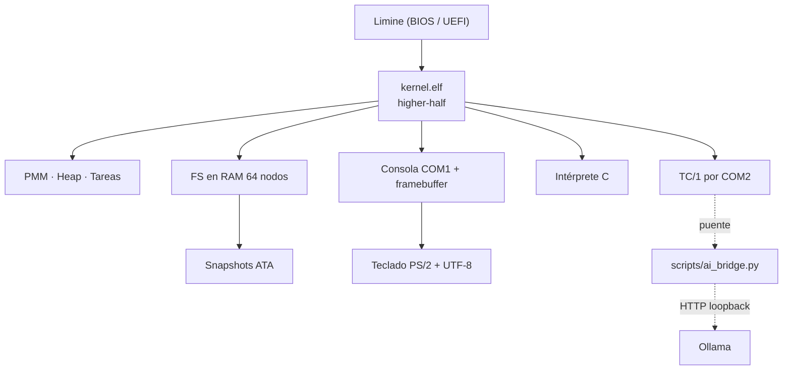

# Toolchain OS

**Un sistema operativo x86-64 escrito desde cero.** Kernel propio en C11 y NASM, sin
librería estándar: memoria física, heap, tareas con cambio de contexto, archivos que
sobreviven al reinicio, texto UTF-8 y un canal de conversación con una IA local.
Arranca en BIOS y UEFI desde una ISO híbrida y se ejecuta en QEMU.

<!-- Badge de CI: requiere el repositorio pantor400/ToolChainOS y la rama main. -->
[](https://github.com/pantor400/ToolChainOS/actions/workflows/ci.yml)
[](LICENSE)
[](#5-subsistemas)
[](#2-compilar-y-ejecutar)
[](artifacts/etapas56-20261029/results.json)
[](#2-compilar-y-ejecutar)


## Qué puedes hacer con él

| | |
|---|---|
| **Arrancar sin sistema anfitrión** | ISO híbrida BIOS/UEFI con Limine 8.x: sin GRUB, sin libc y sin dependencias en tiempo de ejecución |
| **Administrar su propia memoria** | PMM por bitmaps hasta 4 GiB y heap por arenas con división, fusión y alineación de 16 bytes |
| **Guardar archivos entre reinicios** | FS en RAM de 64 nodos con snapshots ATA alternados, generación y recuperación ante corrupción |
| **Arrancar desde un pendrive** | La ISO es híbrida (El Torito BIOS + partición EFI) y se copia tal cual a un USB; arranca igual que desde CD. Para Secure Boot se firma el cargador con claves propias |
| **Leer memorias USB** | Controladora xHCI por PCI, almacenamiento masivo BOT/SCSI y montaje FAT12/16/32 desde la shell; avisa de medios LUKS o BitLocker sin intentar descifrarlos |
| **Ejecutar tareas concurrentes** | 16 PCB/TCB, pilas de 16 KiB con canario y Round Robin cooperativo con contexto en NASM |
| **Hablar UTF-8 de verdad** | Validación estricta, teclado ES-LATAM/US con teclas muertas y glifos españoles en framebuffer |
| **Trabajar en un escritorio** | GUI de tema claro a 1280x720 (por defecto, con la ventana de QEMU a escala 1:1) o a 1920x1080/1280x800 con `RES`, con ventanas, dock, arrastre, repintado por zonas, puntero PS/2 sin retardo y reloj local en la barra. La ventana activa lleva el título y el marco en azul y es la única que recibe el teclado |
| **Consultar el sistema y los archivos** | Ventana Sistema con CPU, núcleos, RAM, heap, tareas, red, ratón y uptime; ventana Archivos con navegación, apertura, creación, borrado y renombrado, los archivos internos del sistema (`/etc`, `/boot`, `/proc`, `/docs`, `/wallpapers`) visibles pero bloqueados en solo lectura, y la ruta completa del elemento marcado en la última línea |
| **Poner tu propio fondo y ver imágenes** | El escritorio usa `images/wallpaper.jpg` como fondo (recortado y escalado en el build); la ventana Imágenes muestra la vista previa de todas las imágenes empaquetadas |
| **Conectar la máquina a la red** | Driver PCI RTL8139 con MAC, ARP, ping ICMP y DNS por UDP sobre la red de usuario de QEMU (IP fija 10.0.2.15/24) |
| **Cargar programas propios** | Cargador ELF64 de PIE estáticos con `host_api_t` v6 (editor, terminal, hoja de cálculo y navegador incluidos en `apps/`), con `is_system` para respetar los archivos internos |
| **Trabajar con una hoja de cálculo** | Rejilla de 8x16 con fórmulas (`=A1+B2`, `=SUMA(A1:B3)`, `=PROMEDIO`, `=MIN`, `=MAX`, `=CONTAR`), guardado y apertura en CSV desde la propia ventana (sección 13) |
| **Conversar con una IA local** | Protocolo binario TC/1 por COM2 hacia Ollama, probado extremo a extremo con UTF-8 |

> **Estado:** 19 de 19 grupos automatizados PASSED, 0 FAILED, 0 BLOCKED, 0 SKIPPED.
> La evidencia reproducible está en
> [`artifacts/etapas56-20261029/`](artifacts/etapas56-20261029/) (`results.json` y los
> registros `*-final.log` de cada grupo).

| Dato | Valor |
|---|---|
| Arquitectura | x86-64, higher-half `0xffffffff80000000` |
| Arranque | Limine 8.x (BIOS y UEFI), ISO híbrida |
| Emulador de referencia | QEMU `qemu-system-x86_64`, máquina `q35`, 256 MiB, 2 vCPU, KVM automático (TCG si no hay `/dev/kvm`) |
| Tamaño del kernel | ~5.4 MiB ELF (`build/kernel.elf`), con las imágenes del escritorio en `.rodata` y sin secciones RWX |
| Estado de validación | **19 de 19 grupos automatizados PASSED**, 0 FAILED/BLOCKED/SKIPPED |
| Licencia | MIT (`LICENSE`) |

## Índice

- [1. Requisitos](#1-requisitos)
- [2. Compilar y ejecutar](#2-compilar-y-ejecutar)
- [3. Teclado](#3-teclado)
- [4. Comandos de la shell](#4-comandos-de-la-shell)
- [5. Subsistemas](#5-subsistemas)
- [6. Arquitectura](#6-arquitectura)
- [7. Estructura del repositorio](#7-estructura-del-repositorio)
- [8. Pruebas](#8-pruebas)
- [9. Límites conocidos](#9-límites-conocidos)
- [10. Documentación](#10-documentación)
- [11. Entrega e integridad](#11-entrega-e-integridad)
- [12. Personalidad Linux (BusyBox en ring 0)](#12-personalidad-linux-busybox-en-ring-0)
- [13. Hoja de cálculo en el escritorio (GUI HOJA)](#13-hoja-de-cálculo-en-el-escritorio-gui-hoja)
- [14. Apagado nativo (APAGAR)](#14-apagado-nativo-apagar)
- [15. Arranque desde USB y Secure Boot](#15-arranque-desde-usb-y-secure-boot)

## 1. Requisitos

Linux x86-64 (o WSL2 con Ubuntu) con:

```bash
gcc  ld  nasm  make  xorriso  python3  qemu-system-x86_64
```

Opcionales:

- `ovmf` para el arranque UEFI (`make uefi`) y para las pruebas de Secure Boot.
- `sbsigntools` (`sbsign`, `sbverify`) para firmar el cargador UEFI con claves
  propias (`make secureboot-iso`). Sin el paquete, la ISO normal sigue arrancando
  con Secure Boot desactivado, pero el firmware no acepta el cargador sin firmar.
- `util-linux` (`lsblk`), `dosfstools` (`mkfs.vfat`) y `mtools` (`mcopy`) para
  `make usb-lista` y `make test-usb`.
- `gdb` para depuración con `make debug`.
- Pillow (`python3-pillow`) para convertir `images/*.jpg` y `*.png` al fondo del
  escritorio y al visor de imágenes (`make images`). Sin Pillow, el build falla al
  generar el blob; `make images-check` lo detecta antes.
- [Ollama](https://ollama.com) en el anfitrión para las pruebas de IA real
  (`make test-ai-real`, `make test-ai-utf8`).

En Ubuntu/WSL:

```bash
bash scripts/setup-ubuntu.sh            # solo informa lo que falta
bash scripts/setup-ubuntu.sh --install  # instala con apt-get
```

El `Makefile` no requiere un cross-compilador: usa `gcc` del sistema con
`-ffreestanding` y `ld` de GNU. Si dispone de uno, puede invocarlo con
`make CROSS=x86_64-elf-`.

## 2. Compilar y ejecutar

Tres comandos y el sistema arranca:

```bash
git clone https://github.com/pantor400/ToolChainOS.git
cd ToolChainOS
make run        # compila el kernel, genera la ISO y arranca QEMU
```

Objetivos disponibles:

```bash
make            # build/kernel.elf
make iso        # build/toolchain-os.iso (ISO híbrida BIOS+UEFI)
make iso RES=1920x1080 # perfil HD (por defecto 1280x720)
make iso RES=1280x800  # perfil compacto
make run FULLSCREEN=1 # ventana a pantalla completa
make run        # arranca en QEMU con salida serie en la terminal
make headless   # igual, sin ventana gráfica
make run ACCEL=tcg   # fuerza emulación por software (sin KVM)
```

Para no ensuciar `build/` (por ejemplo, al verificar cambios):

```bash
make BUILD=/tmp/qos-verify iso
```

Objetivos auxiliares:

| Objetivo | Efecto |
|---|---|
| `make check` | Valida el ELF con `scripts/check_elf.py` (entrada, secciones, W^X) |
| `make inspect` | Genera `build/elf.txt`, `disassembly.txt`, `symbols.txt` y `kernel.map` |
| `make images` | Regenera `build/assets/images.bin` desde `images/` (fondo y visor) |
| `make images-check` | Comprueba Pillow y que haya imágenes antes de compilar |
| `make debug` | QEMU con GDB escuchando **solo** en `127.0.0.1:1234` |
| `make trace` | Registro de interrupciones en `build/interrupts.log` |
| `make uefi` | Arranque UEFI con OVMF (`OVMF_CODE`/`OVMF_VARS` configurables) |
| `make usb-lista` | Enumera unidades extraíbles con `lsblk`; no escribe nada |
| `make test-usb` | Pruebas USB en QEMU: FAT32, escritura, persistencia, LUKS, solo lectura y arranque BIOS/UEFI desde el pendrive |
| `make secureboot-claves` | Genera la clave y el certificado propios en `build/secureboot/` |
| `make secureboot-iso` | Firma el cargador y deja `build/toolchain-os-secureboot.iso` |
| `make test-secureboot` | Control sin Secure Boot y rechazo del cargador sin firmar con OVMF |
| `make clean` | Borra `build/` |

Dentro de QEMU, la salida se lee por COM1 (`-serial stdio`) y la entrada se escribe en
la misma terminal. `HALT` detiene la CPU huésped; para salir, cierre QEMU.

## 3. Teclado

Al arrancar se pregunta la distribución. Sin respuesta en 3 segundos se usa
**ES-LATAM** (español latinoamericano).

- `1` — Español latinoamericano (Ñ, acentos, `¿`, `¡` por teclas muertas).
- `2` — English (US).
- `TECLADO [ES|US|1|2]` — cambia la distribución en caliente.

La entrada por el terminal anfitrión llega como **UTF-8** y no depende del mapa PS/2,
así que `IA ¿Qué es la memoria virtual?` funciona aunque el mapa activo sea US.

## 4. Comandos de la shell

Los comandos se escriben en **mayúsculas**; los argumentos de texto son libres.
`CANCELAR` abandona cualquier entrada guiada (fuera del editor) y `HELP` imprime esta
misma lista desde el kernel.

### Sistema y utilidades

| Comando | Descripción |
|---|---|
| `HELP`, `INFO`, `MEM`, `UPTIME` | Ayuda, resumen del sistema, memoria y ticks del PIT |
| `SUMA [a b]` | Suma en NASM (`asm_sumar`) o entra en modo guiado |
| `TEXTO [texto]`, `ECO texto` | Entrada guiada / eco inmediato |
| `COLOR [nombre]`, `FONDO [nombre]` | Color de texto y de fondo |
| `LIMPIAR`, `HALT` | Borra la pantalla / detiene la CPU |
| `APAGAR` | Apagado total: cierra el escritorio, sincroniza el sistema de archivos y envía ACPI S5 al equipo (sección 14) |
| `EXTEST DE`, `EXTEST PF` | Provoca una excepción para ver el manejador |

### Archivos y editor

| Comando | Descripción |
|---|---|
| `LS`, `DIR [ruta]`, `PWD`, `CD [ruta]` | Listar y navegar el árbol |
| `TREE [ruta]` | Árbol de archivos desde la ruta indicada |
| `MKDIR [ruta]` | Crear carpeta (alias `CREAR_CARPETA`) |
| `CREAR [ruta texto]`, `TOUCH` | Crear archivo con contenido o vacío |
| `OPEN [archivo]`, `EDIT archivo` | Leer o editar |
| `RM archivo`, `RMDIR carpeta`, `REN ruta nuevo`, `COPY origen destino` | Borrar, renombrar y copiar |
| `CANCELAR` | Sale de una entrada guiada |

Dentro de `EDIT>`: `:show`, `:clear`, `:line N texto`, `:del N`, `:wq` (guardar) y
`:q` (descartar). Cualquier otra línea se añade como texto y `BACKSPACE` corrige.

El árbol incluye archivos internos que el sistema vuelve a sembrar en cada arranque:

| Ruta | Contenido |
|---|---|
| `/etc/motd`, `/etc/os-release`, `/etc/hostname`, `/etc/fstab` | Mensaje del día, identidad del sistema y tabla de montajes real |
| `/boot/limine.conf` | Configuración del cargador con la resolución solicitada |
| `/proc/version`, `/proc/cpuinfo` | Versión del kernel y rasgos de la CPU detectados |
| `/docs/LEEME.txt`, `/docs/COMANDOS.txt`, `/docs/GUI.txt`, `/docs/ARCHIVOS.txt` | Documentación del propio sistema: órdenes de la consola, teclas del escritorio y organización del árbol |
| `/wallpapers/<imagen>` | Una ficha por cada imagen empaquetada, con el mismo nombre que el archivo de `images/` (`wallpaper.jpg`, `Logo.jpg`, `Wallpaper0.jpg`) |

Estos nodos se pueden leer (`LS /etc`, `OPEN /etc/motd`, `GUI EDIT /etc/motd`), pero
`RM`, `REN`, `COPY` y la escritura desde las apps los rechazan con
`ARCHIVO DEL SISTEMA: SOLO LECTURA`; el editor y la ventana Archivos los marcan y
deshabilitan los botones de borrado y renombrado. Copia su contenido a otro archivo
si necesitas modificarlo.

#### La galería de `/wallpapers` sale del propio blob

`images/` es la única fuente de verdad de las imágenes: `scripts/build_images.py`
convierte cada JPEG/PNG a RGB565 y guarda en el blob su nombre, sus dimensiones y
su extensión. Al arrancar, `fs_seed_gallery()` recorre ese catálogo y publica en
`/wallpapers` una ficha por imagen con el nombre real del archivo de origen y sus
datos medidos. De ahí sale la coherencia que se ve en pantalla: la ventana
Imágenes y el explorador enumeran exactamente las mismas imágenes, `ENTRAR` sobre
una ficha abre el visor con esa imagen, y el pie del visor y la línea de estado
del explorador muestran la ruta (`/wallpapers/Logo.jpg`). Un archivo con extensión
de imagen que no esté en el blob ya no abre una imagen cualquiera: se avisa de que
no está empaquetada.

### Memoria, interrupciones y tareas

| Comando | Descripción |
|---|---|
| `MEMSTATS`, `PMMTEST` | Estadísticas del PMM y prueba de páginas |
| `HEAPSTATS`, `HEAPTEST`, `MEMMAP` | Estado del heap, prueba de estrés y mapa de Limine |
| `PS`, `THREADS` | Procesos y hilos del kernel |
| `SCHED`, `SCHED TEST` | Estado del planificador Round Robin y prueba de conmutación |
| `PROC TEST`, `TASKS`, `TASKS START` | Demostración de procesos y tareas cooperativas |

### Escritorio, red y aplicaciones ELF

| Comando | Descripción |
|---|---|
| `GUI` | Abre el escritorio interactivo; `ESC` vuelve a la consola salvo que la ventana activa use esa tecla |
| `GUI DEMO` | Dibuja un fotograma y restaura la consola (prueba rápida) |
| `GUI RUN <índice>` | Lanza directamente un módulo ELF desde el escritorio |
| `GUI EDIT <archivo>` | Abre el editor gráfico con ese archivo ya cargado |
| `GUI HOJA` | Abre el escritorio con la hoja de cálculo ya cargada (sección 13); también se lanza desde la ventana **Apps** |
| `RED`, `RED ARP` | Estado del RTL8139 (MAC, IP, puerta, DNS, enlace, contadores) y sondeo ARP |
| `RED PING <ip>` | Eco ICMP con tiempo de ida y vuelta (`RED PING 10.0.2.2`) |
| `RED DNS <nombre>` | Resuelve un nombre contra el DNS de QEMU (`RED DNS example.com`) |
| `RED INTERNET` | Prueba completa: ping a la puerta y resolución de ejemplo |
| `RATON` | Estado del ratón PS/2: posición, botones y paquetes por IRQ12 |
| `HORA` | Hora local del anfitrión desde el CMOS (también en la barra superior) |
| `ELF`, `ELF RUN <índice>` | Lista los módulos Limine y ejecuta uno |
| `LINUX <applet> [args]` | Ejecuta un applet de BusyBox con la personalidad Linux (sección 12) |
| `LINUX LIST`, `LINUX INFO`, `LINUX TRACE` | Binarios disponibles, estado de SYSCALL y traza de llamadas |

Las apps reciben `host_api_t` en `RDI` (ABI 6): ventana propia, primitivas con el
tema del sistema, eventos relativos a su lienzo, sistema de archivos del kernel
(`read_file`, `write_file`, `make_dir`, `remove_node`, `rename_node`, `nodes`,
`cwd`/`chdir`, `is_system`), `exec` para lanzar órdenes del shell capturando la
salida y `launch_file` con la ruta con la que el escritorio lanzó la app
(`Archivos > Editar` o `GUI EDIT`). `ESC` o el botón de cerrar las devuelve al
escritorio, que recupera el área ocupada sin dejar restos. Se compilan con
`make apps`.

El editor arranca con una plantilla en blanco sin nombre; los botones **Abrir**
y **Guardar** de su barra abren un selector con el árbol del sistema de archivos
(directorio actual, `..` y lista de hijos) para elegir qué leer y en qué carpeta
dejar el texto. Los archivos internos aparecen marcados como `sistema`: se abren
con `[solo lectura]` en la barra y ninguna tecla de edición los modifica. El área
de texto y la pantalla de la terminal ajustan el texto al ancho real de la
ventana y añaden una barra de desplazamiento vertical que aparece cuando el
contenido no cabe; el pulgar se puede pulsar y arrastrar con el ratón.

La terminal ajusta por palabras y, si una palabra sola no cabe, recorta la línea
por caracteres UTF-8 completos: la ruta, cada renglón y el pie de ayuda terminan
dentro del recuadro y nunca se pintan bajo la barra de desplazamiento. La salida
de una orden se guarda entera (4 KiB, así que `HELP` ya no queda a medias) y el
eco `OS> orden` empieza siempre en línea nueva, de modo que dos salidas seguidas
no se pegan.

La hoja de cálculo (`apps/hoja.c`, sección 13) es la tercera app ELF del sistema y
se abre desde la ventana **Apps** o con `GUI HOJA`: rejilla
de 8x16 celdas, fórmulas con referencias y funciones de rango, y botones
**Guardar**, **Abrir** y **Limpiar** que trabajan sobre `hoja.csv` del directorio
actual. La barra superior muestra la celda activa y su contenido, y el pie recuerda
las teclas: flechas para moverse, `RET` para bajar, `TAB` para avanzar, `SUPR` para
vaciar la celda y `HOME`/`END` para ir a la primera o a la última columna.

Solo hay una ventana de aplicación a la vez. Tanto ella como las del dock
atienden el teclado únicamente cuando son la **ventana activa**: se cambia con
un clic en la ventana o en su botón del dock, la recién abierta queda activa, al
cerrarla el foco pasa a la que esté más arriba y la activa se distingue por el
título y un marco azul que sigue las esquinas redondeadas de la ventana. Las
teclas nunca llegan a una ventana inactiva, y `ESC` cierra el escritorio solo si
la ventana activa no lo consume (por ejemplo, el visor de contenido de Archivos).

El escritorio toma `images/wallpaper.jpg` como fondo. `scripts/build_images.py`
recorta la imagen al aspecto del modo de vídeo, la reduce a `RES` y la convierte a
RGB565, y `objcopy` la enlaza en `.rodata.images`; no hay decodificador JPEG/PNG en
el kernel. La ventana **Imágenes** del dock lista todo lo empaquetado con su tamaño
y una vista previa escalada, y `Archivos > abrir` sobre un `.jpg`, `.jpeg` o `.png`
lleva directamente a esa imagen. Para cambiar el fondo basta con reemplazar
`images/wallpaper.jpg` y recompilar; sin imágenes, el escritorio vuelve al degradado.

### USB y almacenamiento extraíble

| Comando | Descripción |
|---|---|
| `USB`, `USB INFO` | Controladora xHCI, medio conectado, particiones y sistema de archivos montado |
| `USB PUERTOS` | Estado de cada puerto: conectado, velocidad y enlace U0 |
| `USB LISTAR` | Archivos del directorio raíz de la FAT montada |
| `USB VER <archivo>` | Vuelca el contenido de un archivo del pendrive |
| `USB IMPORTAR <archivo>` | Copia el archivo al FS en RAM (queda en el directorio actual) |
| `USB LEER <sector>` | Volcado hexadecimal de los primeros 64 bytes del sector |
| `USB ESCRIBIR <sector> <texto>` | Escribe un sector de 512 bytes (se rechaza si el medio está protegido) |
| `USB REINICIAR` | Reinicia la controladora y vuelve a enumerar los puertos (hotplug) |

Al arrancar, el kernel informa de la controladora, del medio y del sistema de
archivos sin necesidad de pedir `USB INFO`. Un medio cifrado (LUKS o BitLocker)
se detecta y se avisa; el kernel **no** intenta descifrarlo ni montarlo.
Detalles en la [sección 15](#15-arranque-desde-usb-y-secure-boot).

### Disco, persistencia e IA

| Comando | Descripción |
|---|---|
| `DISK INFO`, `DISK READ <LBA>`, `DISK MBR`, `DISK TEST` | Inspección ATA PIO (LBA28) |
| `FSSTATUS` | Compara la imagen en RAM con la copia en disco |
| `RUN CPP [archivo]`, `RUN_CPP [archivo]` | Intérprete de un subconjunto de C |
| `IA <pregunta>`, `IA STATUS`, `IA CANCEL` | Consulta a Ollama a través del puente COM2 |
| `AGENTE <objetivo>` | Agente de bajo nivel: la IA ejecuta órdenes de consola con lista blanca |
| `AGENTE ESCRITURA ON`, `AGENTE ESCRITURA OFF` | Habilita o revoca las órdenes que modifican el FS |

Ejemplo de uso de la IA:

```bash
ollama serve &                                   # anfitrión, modelo qwen2.5:0.5b
python3 scripts/ai_bridge.py --serial /dev/pts/N # puente COM2 <-> Ollama
make run-ai                                      # QEMU con el puerto conectado
```

Ejemplo del agente de bajo nivel (la IA decide y ejecuta, el kernel valida):

```bash
python3 scripts/ai_agent.py --goal "revisa la memoria y el FS"   # arranca la VM
python3 scripts/ai_agent.py --attach --script "pwd\nls\nmem"     # sin modelo
```

El kernel abre una sesión `TC/1` (tipo 4), recibe cada orden como tipo `0x84`,
la valida contra su lista blanca, la ejecuta capturando la salida real y devuelve
esa salida como tipo 5. La sesión termina por pasos, por `0x85` o por timeout.


## 5. Subsistemas

| Módulo | Archivos | Responsabilidad |
|---|---|---|
| Arranque | `src/kernel.c`, `limine.conf`, `linker.ld` | Peticiones de Limine, base HHDM, bucle de la shell |
| Memoria física | `src/pmm.c` | Bitmap de páginas de 4 KiB hasta 4 GiB, reservas y mapa |
| Heap | `src/heap.c` | Arenas contiguas de hasta 64 páginas, bloques con cabecera y *coalescing* |
| Tareas | `src/tasks.c`, `src/context.asm` | 16 PCB/TCB, pilas de 4 páginas con canario, cambio de contexto |
| Interrupciones | `src/interrupts.c`, `interrupt_stubs.asm` | IDT, excepciones con volcado de registros, PIT a 100 Hz |
| Consola | `src/console.c`, `include/font.h` | COM1 más framebuffer RGB con rejilla de caracteres y suspensión al abrir la GUI |
| Escritorio | `src/gui.c`, `src/font_ui.c`, `include/gui.h` | Doble buffer en PMM, tema claro, ventanas con foco de teclado, dock, iconos, reloj, cursor y fondo por imagen |
| Imágenes | `src/images.c`, `include/images.h`, `scripts/build_images.py` | Blob RGB565 `.rodata.images`, fondo escalado con tablas y visor con vista previa |
| Ratón | `src/mouse.c`, `include/mouse.h` | i8042 + IRQ12, paquetes de 3 bytes y sondeo de respaldo |
| Red | `src/net.c`, `include/net.h` | PCI 0xCF8/0xCFC, RTL8139, Ethernet, ARP, IPv4 con ICMP y DNS por UDP |
| USB | `src/usb.c`, `include/usb.h` | xHCI por PCI, anillos y TRB, enumeración, BOT/SCSI y API de sectores |
| USB: archivos | `src/usb_fat.c`, `include/usb_fat.h` | MBR/GPT, FAT12/16/32 de solo lectura e importación al FS; avisa de LUKS/BitLocker |
| MMIO | `src/mmio.c`, `include/mmio.h` | Mapeo bajo demanda de BAR fuera del mapa de Limine con tablas propias |
| Reloj | `src/rtc.c`, `include/rtc.h` | Hora local del CMOS (BCD/binario, 12/24 h) para la barra y `HORA` |
| Apps ELF | `src/elf.c`, `src/elf_enter.asm`, `apps/`, `include/host_api.h` | Carga de PIE estáticos, reubicaciones y contrato de hospedaje |
| Ofimática | `apps/hoja.c` | Hoja de cálculo de 8x16 con fórmulas, cálculo de rangos y CSV |
| Texto | `src/utf8.c`, `src/glyph.c`, `src/keyboard.c` | UTF-8 estricto, glifos, teclado PS/2 bilingüe con teclas muertas |
| Sistema de archivos | `src/fs.c` | Árbol en RAM de 64 nodos con rutas, copia y renombrado |
| Persistencia | `src/storage.c`, `src/ata.c` | Snapshots alternados en el MBR extendido, FNV-1a y generación |
| Editor | `src/editor.c` | Edición transaccional línea a línea |
| Intérprete | `src/cpp_runner.c` | Subconjunto de C: funciones, control de flujo y aritmética de 64 bits |
| Puente IA | `src/ai_serial.c`, `scripts/ai_bridge.py` | Protocolo binario `TC/1` por COM2 y adaptador a la API de Ollama |
| Agente IA | `src/agent.c`, `scripts/ai_agent.py` | Lista blanca de órdenes, ejecución en el shell y captura de la salida real |
| Apagado | `src/power.c`, `include/power.h` | Cierre ordenado (escritorio y FS) y ACPI S5 por `PM1a_CNT` |

## 6. Arquitectura



Decisiones y su justificación: [`docs/diseno/DECISIONES_TECNICAS.md`](docs/diseno/DECISIONES_TECNICAS.md).
Recorrido del código: [`docs/guias/GUIA_CODIGO.md`](docs/guias/GUIA_CODIGO.md).

## 7. Estructura del repositorio

```text
README.md  LEEME_PRIMERO.txt  LEEME_ENTREGA.md  CHANGELOG.md  LICENSE
Makefile   linker.ld  limine.conf  MANIFEST_SHA256.json  SHA256SUMS
INICIAR_DEMO_LINUX.sh  INICIAR_DEMO_WINDOWS.bat

src/            kernel y subsistemas en C11 y NASM
apps/           aplicaciones ELF64 (editor.c, terminal.c, hoja.c)
include/        cabeceras del kernel y host_api.h
images/         JPEG/PNG de origen (wallpaper.jpg es el fondo por defecto)
scripts/        pruebas, empaquetado y validación (Python 3)
docs/           INDICE.md con el orden de lectura
  diseno/       arquitectura, decisiones y fases
  guias/        explicación, guía de código, demostración y teclado
  informes/     avance, cierre, informe final e informe académico (.docx)
  validacion/   pruebas, validación, auditoría, diagnóstico y recuperación
  auditoria/    revisión del código con las correcciones pendientes
  etapas56-diagramas/  diagramas del informe
artifacts/      evidencias de la validación E56 (resultados y registros)
vendor/         binarios de Limine y BusyBox (linux-bin/)
build/          kernel.elf, toolchain-os.iso e imágenes de prueba (generado)
```

## 8. Pruebas

```bash
make test-memory-host     # PMM y heap con ASan/UBSan (host)
make test-utf8-host       # UTF-8, teclado, glifos y FS (host)
make test-scheduler-host  # cambio de contexto (host)
make test-agent           # agente de bajo nivel (QEMU)
make test-all             # regresión completa en QEMU (incluye ai-agent)
python3 -B scripts/test_ai_protocol.py   # protocolo TC/1 sin IA (host)
```

Las pruebas de host usan `-fsanitize=address,undefined`. Si la distribución no
trae `libasan`/`libubsan` (por ejemplo Fedora sin el paquete de sanitizers),
`make SAN= test-memory-host` las ejecuta sin ellos; el código y las aserciones
son los mismos.

Pruebas que arrancan QEMU:

| Objetivo | Cubre |
|---|---|
| `make smoke` | Arranque y consola |
| `make test-core` | Comandos del núcleo y excepciones |
| `make test-files` | Archivos y editor |
| `make test-persistence` | Snapshots ATA, recuperación y corrupción |
| `make test-keyboard` | Teclado español/US y texto UTF-8 |
| `make test-utf8-persistence` | UTF-8 persistido entre arranques |
| `make test-scheduler` | Round Robin y recuperación de tareas |
| `make test-gui` | GUI, fondo por imagen, visor de imágenes, reloj del CMOS, repintado por zonas, ratón por IRQ12, RTL8139 con ICMP/DNS, ventanas Sistema/Archivos, archivos internos de solo lectura, apps editor/terminal, hoja de cálculo (fórmula, edición y guardado en CSV), ventana activa y aislamiento del teclado entre ventanas |
| `make test-raton` | Puntero: ráfaga de movimientos relativos con posición final exacta, sin bytes descartados y sin rastro del cursor en las capturas PPM |
| `make test-uefi` | Arranque UEFI con OVMF |
| `make test-usb` | USB completo: xHCI, BOT/SCSI, FAT32 con listar/ver/importar, escritura y persistencia de un sector, aviso LUKS, medio de solo lectura y arranque desde el propio pendrive por BIOS y UEFI |
| `make test-secureboot` | Secure Boot: arranque de control con OVMF, rechazo del cargador sin firmar y comprobación de la firma propia |
| `make test-ai-bridge` | Transporte TC/1 contra un mock |
| `make test-agent` | Agente de bajo nivel: sesión TC/1, lista blanca y rechazo de `halt` |
| `make test-ai-real` | IA real contra Ollama |
| `make test-ai-utf8` | Pregunta en UTF-8 extremo a extremo |
| `make test-linux-bin` | Personalidad Linux: ISO variante, SYSCALL, applets de BusyBox y órdenes delegadas |
| `make test-apagar` | Apagado nativo: `APAGAR` por consola; espera el evento QMP `SHUTDOWN` de QEMU |

El workflow [`ci.yml`](.github/workflows/ci.yml) repite en GitHub Actions la
compilación, la verificación del ELF y las pruebas de host (PMM, heap, UTF-8,
teclado, glifos, FS y planificador), además de publicar la ISO como artefacto.
Instala `python3-pil` antes de compilar porque el blob de imágenes del escritorio
se genera en el anfitrión; el badge del encabezado refleja ese estado en `main`.

Validación y empaquetado del cierre:

```bash
python3 scripts/validate_etapas56.py      # 19 pasos, deja registros en artifacts/
python3 scripts/package_etapas56.py       # ZIP de entrega y verificación de protegidos
```

## 9. Límites conocidos

- El planificador es **cooperativo**: una tarea no se expropia por temporizador.
- La GUI se dibuja por software, sin SSE ni aceleración; el modo de vídeo se elige
  en el build (`make iso RES=1920x1080` para el perfil HD) y no cambia en
  caliente. El escritorio repinta solo las zonas marcadas como sucias y espera
  con `hlt` cuando no hay eventos, de modo que un anfitrión sin KVM sigue siendo
  usable.
- El ratón es PS/2 relativo: un touchpad funciona en modo compatibilidad, sin
  driver Synaptics/Elan absoluto, y no hay rueda ni doble puntero. La IRQ12 llega
  por la cascada del PIC y se drena junto al teclado con las interrupciones
  cerradas, así que no se pierden paquetes ni quedan estelas del cursor. Un
  desplazamiento que desborde el paquete de 3 bytes (más de ±255 cuentas en
  10 ms) se aplica con la parte que trae el byte, sin detener el puntero.
- La red llega a Ethernet + ARP + IPv4 (ICMP y DNS por UDP) con IP fija
  10.0.2.15/24: no hay TCP/IP, DHCP ni IPv6, y el RTL8139 se atiende por sondeo,
  no por IRQ. Sin TCP no se puede abrir una página web ni ejecutar clientes que
  dependan de sockets.
- Las apps ELF corren en **ring 0** sin aislamiento; el `host_api_t` es la frontera
  y `elf_abort()` recupera el control si la app provoca una excepción. La ejecución
  es bloqueante, así que el escritorio mantiene una sola ventana de app a la vez.
- El sistema de archivos vive en RAM (64 nodos) y se guarda como snapshot completo; no
  hay journaling ni bloques libres reutilizables entre snapshots.
- Los archivos internos (`/etc`, `/boot`, `/proc`, `/wallpapers`) se vuelven a sembrar
  en cada arranque y en cada lectura de disco: son de solo lectura y su contenido no
  se persiste.
- Las imágenes se convierten en el anfitrión: el kernel no decodifica JPEG ni PNG,
  admite hasta 8 (`IMAGES_MAX`) y cada fondo de 1280x720 ocupa ~1.8 MiB en
  `.rodata.images`, que forma parte del kernel.
- `cpp_runner` implementa un subconjunto de C: sin punteros, `struct`, `switch` ni
  librerías, y con un tope de 500 000 pasos por ejecución.
- ATA es PIO LBA28 con un único dispositivo maestro; no hay DMA ni IRQ14.
- USB usa **solo xHCI** (la controladora de la máquina q35 en QEMU); EHCI y UHCI
  no están implementados y el acceso es por sondeo, sin interrupciones. Se
  atiende un único dispositivo de almacenamiento y su enumeración ocurre al
  arrancar o al pedir `USB REINICIAR`.
- El montaje USB es FAT12/16/32 de **solo lectura y solo del directorio raíz**:
  no hay subdirectorios, nombres largos ni escritura del sistema de archivos.
  `USB ESCRIBIR` escribe sectores crudos, no archivos.
- LUKS y BitLocker se detectan y se avisan; el kernel no descifra ni monta esos
  medios porque no tiene claves ni implementa sus formatos.
- Secure Boot no se desactiva ni se salta: el arranque firmado exige
  `sbsigntools` e inscribir el certificado propio en el firmware (MOK o
  KeyTool). Sin firma, un firmware con Secure Boot rechaza la ISO, que es el
  comportamiento correcto.
- El puente de IA exige `http://127.0.0.1` o `localhost` y responde en texto plano
  troceado en tramas de 1 KiB.
- El agente trabaja **solo lectura** salvo `AGENTE ESCRITURA ON`, acepta como máximo
  8 pasos por sesión y no puede ejecutar `HALT`, `EXTEST`, `EDIT` ni `LIMPIAR`.
- El kernel no tiene modo usuario ni paginación por proceso: las apps ELF y los
  binarios Linux (sección 12) corren en ring 0. Eso alcanza para utilidades de
  consola estáticas como BusyBox. Un programa con enlace dinámico y gráficos
  (LibreOffice, Gnumeric, Abiword) quedaría fuera: necesita cargador `ld-musl`,
  GTK3 sobre X11, hilos con `futex` y señales reales, y nada de eso existe aquí.
- El hipervisor VT-x se retiró: el escritorio y la consola ya no tienen ventana
  ni órdenes `VMX`. La ofimática nativa del sistema es la hoja de cálculo de la
  sección 13, sin ninguna capa de virtualización por debajo.
- El apagado (sección 14) escribe S5 directamente en `PM1a_CNT` de los puertos
  0x604 (QEMU q35/i440fx) y 0xB004 (Bochs) porque la FADT real vive en la memoria
  reservada baja, que el HHDM de Limine no mapea y el kernel no tiene paginador
  propio para alcanzarla. En un equipo físico con otros puertos ACPI el S5 no
  llegaría y el sistema se detiene avisando por COM1; tampoco hay reinicio,
  suspensión ni batería.
- El proyecto apunta a gcc/ld de Linux; en macOS o Windows nativo no compila.

Revisión del código con las correcciones pendientes y las funciones duplicadas:
[`docs/auditoria/REVISION_FUNCIONES.md`](docs/auditoria/REVISION_FUNCIONES.md).

## 10. Documentación

| Documento | Contenido |
|---|---|
| [`docs/INDICE.md`](docs/INDICE.md) | Índice y orden de lectura sugerido |
| [`docs/diseno/ARQUITECTURA.md`](docs/diseno/ARQUITECTURA.md) | Diseño de los subsistemas |
| [`docs/diseno/GUI_RED_APPS.md`](docs/diseno/GUI_RED_APPS.md) | Escritorio, assets, ratón, red y apps ELF |
| [`docs/guias/EXPLICACION.md`](docs/guias/EXPLICACION.md) | Del código al arranque, paso a paso |
| [`docs/guias/GUIA_DEMOSTRACION.md`](docs/guias/GUIA_DEMOSTRACION.md) | Guion de demostración |
| [`docs/validacion/PRUEBAS_Y_RESULTADOS.md`](docs/validacion/PRUEBAS_Y_RESULTADOS.md) | Pruebas y resultados |
| [`docs/informes/CIERRE_ETAPAS56.md`](docs/informes/CIERRE_ETAPAS56.md) | Cierre de las etapas 5 y 6 |
| [`CHANGELOG.md`](CHANGELOG.md) | Historial de versiones |

## 11. Entrega e integridad

`MANIFEST_SHA256.json` y `SHA256SUMS` sellan los archivos publicados. Para comprobar
que una copia no ha sido alterada:

```bash
sha256sum -c SHA256SUMS
```

`artifacts/etapas56-20261029/protegidos.json` registra además los ZIP de entregas
anteriores y las imágenes de disco usadas en la validación; si esos binarios no están
presentes en su copia, `scripts/package_etapas56.py` detendrá el empaquetado con un
error de integridad, que es el comportamiento esperado.

## 12. Personalidad Linux (BusyBox en ring 0)

El **kernel propio** atiende las llamadas al sistema de un binario Linux y lo
ejecuta dentro de su propio espacio de direcciones. El programa es BusyBox de
Alpine, compilado con musl y enlace estático; el kernel lo carga como módulo Limine
y salta a su punto de entrada sin `fork`, sin `exec` y sin cambio de privilegio.

```bash
make linux-bin       # una vez: descarga BusyBox con podman y lo deja en vendor/linux-bin
make run-linux       # arranca la ISO variante con el binario dentro
make test-linux-bin  # verifica ISO, SYSCALL y cuatro applets de punta a punta
make linux-bin-check # informa de lo aprovisionado, sin descargar nada
```

Dentro de QEMU:

```text
OS> linux uname -m
x86_64
LINUX: FIN CODIGO=0 SYSCALLS=7
OS> linux ls /
boot        docs        etc         nota        proc        script      wallpapers
```

### Cómo se ejecuta un binario Linux

1. `src/elf.c` carga la imagen PIE estática (`elf_load_image`): copia los segmentos,
   pone a cero el `.bss` y aplica `R_X86_64_RELATIVE`. Las reubicaciones RELR las
   aplica el propio binario en su `_dlstart`, como haría en Linux.
2. `linux_abi_init` programa `EFER.SCE`, `STAR`, `LSTAR` y `FMASK` para que la
   instrucción `SYSCALL` entre en `linux_syscall_entry` (`src/linux_enter.asm`), y
   habilita SSE en `CR0`/`CR4` porque el kernel se compila con `-mgeneral-regs-only`
   y musl usa `xmm` en `memcpy`.
3. `src/linux_abi.c` arma la pila inicial con `argc`, `argv`, entorno vacío y `auxv`
   (`AT_PHDR`, `AT_ENTRY`, `AT_RANDOM`, `AT_EXECFN`…), salta al `_start` del binario
   y despacha sus llamadas: identidad, memoria (`brk`, `mmap`, `munmap`), tiempo,
   descriptores sobre el sistema de archivos en RAM (con `getdents64`, `sendfile` y
   `ioctl` de terminal), señales vacías y `exit_group`.
4. Cuando el programa llama a `exit_group` o provoca una excepción, `linux_abort`
   deshace su pila, libera lo que tomó del PMM y devuelve el control a la shell.

El resultado es un programa de terceros ejecutándose de verdad sobre el kernel
propio: `linux echo`, `linux uname`, `linux ls /` y `linux cat /etc/hostname`
imprimen su salida real y terminan con código 0.

### Órdenes del shell atendidas por BusyBox

Cuando la ISO lleva el binario, el shell no usa su propia implementación de `LS`,
`TREE` ni `OPEN`: compone la línea (`ls`, `find`, `cat`) y se la entrega al applet
real, que trabaja contra el mismo sistema de archivos en RAM. Aparecen además
`GREP`, `WC`, `SORT`, `HEAD`, `TAIL`, `FIND`, `STAT` y `OD`, que el kernel no
implementa. La delegación no imprime el preámbulo de estado (`LINUX: EJECUTANDO`…)
porque el usuario pidió el listado, no un informe:

```text
OS> ls /
boot        docs        etc         nota        proc        script      wallpapers
OS> open /etc/hostname
toolchainos
OS> grep toolchainos /etc/hostname
toolchainos
```

La ISO entregada (`make iso`) no contiene el binario, así que allí esas mismas
órdenes siguen resolviéndose con el código propio: la delegación se activa sola
cuando `vendor/linux-bin/busybox.static` viaja en la ISO.

### Qué se versiona

| Ruta | Contenido | Versionado |
|---|---|---|
| `vendor/linux-bin/busybox.static` | BusyBox 1.37 de Alpine (1 MiB) | sí |
| `vendor/linux-bin/provisionado.json` | Versión del paquete y SHA-256 del binario | sí |
| `vendor/linux-bin/licencias/`, `ORIGEN.md` | Texto GPL-2.0, procedencia y applets | sí |

La ISO entregada (`make iso`) no cambia: el binario viaja en
`build/toolchain-os-busybox.iso`, una variante que solo se construye cuando existe
`vendor/linux-bin/busybox.static`.

### Límites y licencias

- Un programa a la vez y sin `fork`: no hay procesos, hilos ni señales reales
  (`futex` responde `ENOSYS`), ni red, ni `stdin` con datos.
- No hay paginación por proceso: `mmap` y `brk` se sirven del PMM con memoria
  contigua y el montón tiene un tope fijo; si se agota, el binario lo ve como
  `ENOMEM`.
- Las rutas que ve el binario son las del sistema de archivos en RAM del kernel, en
  solo lectura: `ls /` lista el árbol de ToolchainOS, no un rootfs de Linux.
- `GREP`, `WC`, `SORT`, `HEAD`, `TAIL`, `FIND`, `STAT` y `OD` solo existen en la ISO
  variante; en la entregada responden que necesitan el binario. `LS`, `TREE` y `OPEN`
  funcionan en ambas: con el applet si está, con el código del kernel si no.
- BusyBox es GPL-2.0 y se ejecuta como **programa separado**, no enlazado: el código
  MIT del kernel no pasa a ser obra derivada. Su licencia y su origen se distribuyen
  junto al binario en `vendor/linux-bin/`.

---

## 13. Hoja de cálculo en el escritorio (GUI HOJA)

La ofimática del sistema es una hoja de cálculo nativa: una aplicación ELF
propia (`apps/hoja.c`) que se abre como una ventana más del escritorio y trabaja
contra el mismo sistema de archivos en RAM. No interviene ninguna máquina
virtual ni intérprete de terceros: es código del kernel y de sus apps corriendo
en ring 0.

```bash
make test-gui   # incluye crear, calcular y guardar una hoja
```

Dentro del escritorio:

```text
OS> gui hoja          (o el botón Apps del dock y "hoja")
hoja.elf: HOJA 8X16 LISTA ABI=6
hoja.elf: FORMULA C1 =b1-a1 -> 2
hoja.elf: CELDA C2 10
hoja.elf: GUARDADO /hoja.csv
```

### La rejilla y las fórmulas

La hoja tiene 8 columnas (A–H) por 16 filas. Cada celda guarda hasta 24
caracteres de texto o una fórmula que empieza por `=`:

| Fórmula | Resultado |
|---|---|
| `=b1-a1` | Resta de dos celdas |
| `=(a1+b1)*2` | Paréntesis y las cuatro operaciones (`+ - * /`) |
| `=SUMA(a1:b3)` | Suma de un rango (también `SUM`) |
| `=PROMEDIO(a1:a4)` | Media entera (`AVERAGE`) |
| `=MIN(a1:b3)` / `=MAX(a1:b3)` | Extremos del rango (`MINIMO`/`MAXIMO`) |
| `=CONTAR(a1:b16)` | Celdas no vacías del rango (`COUNT`) |

Las referencias se escriben en mayúsculas o minúsculas indistintamente. Toda la
aritmética es entera, porque las apps se compilan con `-mgeneral-regs-only` y no
enlazan `libgcc`; una fórmula imposible muestra `#ERROR` y una referencia
circular `#CICLO`.

### Teclado y ratón

| Control | Efecto |
|---|---|
| Flechas | Mueven la celda activa |
| RET | Baja de fila; vuelve a dibujar el valor calculado |
| TAB | Avanza de columna |
| BACKSPACE | Borra el último carácter |
| SUPR | Vacía la celda |
| HOME / END | Primera y última columna |
| Ratón | Elige celda y pulsa **Guardar**, **Abrir** o **Limpiar** |

ESC cierra la ventana como en el resto de apps, y el escritorio sigue
atendiendo al teclado solo cuando esa ventana tiene el foco.

### Persistencia

**Guardar** escribe `hoja.csv` en el directorio de trabajo actual del sistema
de archivos en RAM, y **Abrir** lo vuelve a leer (acepta `,`, `;`, `\r\n` y
`\n`). Como el CSV es texto plano, la propia terminal y los applets de BusyBox
pueden inspeccionarlo:

```text
OS> open hoja.csv
5,7
=b1-a1,10
```

El archivo cabe en el tope de 1 KiB del sistema de archivos, por eso la hoja
recorta las columnas vacías del final de cada fila.

### Marcadores de prueba

La app escribe en el puerto serie lo que hace, de modo que `make test-gui`
verifica el cálculo y el guardado sin capturas de pantalla:

`hoja.elf: HOJA 8X16 LISTA ABI=6`, `hoja.elf: ABIERTO <ruta>`,
`hoja.elf: SIN ARCHIVO <ruta>`, `hoja.elf: GUARDADO <ruta>`,
`hoja.elf: ERROR GUARDADO <ruta>`, `hoja.elf: HOJA VACIA`,
`hoja.elf: CELDA <celda> <texto>`,
`hoja.elf: FORMULA <celda> <texto> -> <valor>|ERROR|CIRCULAR` y
`hoja.elf: fin correcto`.

La evidencia visual se regenera con `python3 scripts/verify_hoja_capture.py`:


---

## 14. Apagado nativo (APAGAR)

`APAGAR` apaga el equipo de verdad desde el propio kernel, sin depender de
QEMU ni de un hipervisor anfitrión: el mismo código que se usa aquí ejecutaría
`ACPI S5` en un PC físico.

```text
OS> apagar
POWER: APAGADO SOLICITADO (COMANDO APAGAR)
POWER: CERRANDO EL ESCRITORIO        (solo si la GUI estaba abierta)
POWER: S5 ENVIADO (SLP_TYP=5 SLP_EN=1; QEMU CON SLP_TYP=0)
```

Antes de cortar la energía, `power_off()` (`src/power.c`) deja el sistema en un
estado consistente y en este orden:

1. Vuelve a la consola si el escritorio estaba abierto (`gui_shutdown()`).
2. Sincroniza el sistema de archivos con `storage_sync()`.
3. Escribe `SLP_TYP=5 | SLP_EN=1` en `PM1a_CNT` (0x604 y 0xB004) y repite con
   `SLP_TYP=0`, que es el valor que interpreta QEMU.
4. Si el firmware no apaga nada, detiene la CPU con `asm_detener()` y avisa por
   COM1 en lugar de seguir girando.

Se puede invocar de dos maneras:

| Origen | Cómo |
|---|---|
| Consola | `APAGAR` |
| Prueba automatizada | `make test-apagar` |

`make test-apagar` arranca la ISO, pide `APAGAR` por el shell y exige el evento
QMP `SHUTDOWN` con `guest: true`, que es la prueba de que el firmware atendió el
S5; el detalle y los registros están en
`docs/validacion/PRUEBAS_Y_RESULTADOS.md`.

### Por qué no se lee la FADT

La dirección real de `PM1a_CNT` está en la FADT, colgada del RSDP y la RSDT en
la memoria reservada baja (0xE0000–0xFFFFF). El HHDM de Limine no mapea esa
zona y el kernel no tiene paginador propio, así que leerla provoca `#PF`
(verificado: CR2 `0xFFFF80000000040E` al leer la palabra del EBDA y
`0xFFFF8000000F5320` al seguir la RSDT). Por eso `power.c` escribe en los
puertos fijos de los firmwares que emula la demo —QEMU q35/i440fx y Bochs—, que
es inofensivo en cualquier otro equipo: un puerto libre ignora la escritura y
el sistema se detiene con aviso por el puerto serie.

---

## 15. Arranque desde USB y Secure Boot

### 15.1 La misma imagen sirve para CD y para pendrive

`make iso` genera una ISO **híbrida**: El Torito para BIOS, partición EFI para
UEFI y una tabla de particiones válida. Copiada tal cual, arranca en un pendrive
igual que desde el CD. `scripts/escribir_usb.py` hace la copia sector a sector y
comprueba el resultado sin tocar nunca el disco del sistema.

```bash
make usb-lista                                    # solo enumera unidades
sudo python3 scripts/escribir_usb.py escribir /dev/sdX
python3 scripts/escribir_usb.py verificar /dev/sdX
```

La escritura exige teclear la frase exacta `ESCRIBIR /dev/sdX`. Antes, el script
rechaza discos con particiones montadas, discos que contienen el sistema en
marcha, discos más pequeños que la imagen y discos que el firmware no marca como
extraíbles (`--forzar` solo para ese último caso). Todo el contenido del pendrive
se pierde.

`verificar` comprueba la firma `0x55AA` del sector 0 y que el cargador Limine
está presente en el primer MiB.

### 15.2 Qué hace el kernel al encontrar un USB

`usb_init()` se ejecuta en el arranque y recorre esta cadena:

1. Busca la controladora xHCI por PCI (clase `0x0C`, subclase `0x03`, progif
   `0x30`) y mapea su BAR. Como el hueco PCI no está en el mapa de Limine,
   `src/mmio.c` crea tablas de página propias (PWT|PCD) recorriendo la
   paginación de 4 niveles desde CR3.
2. Reinicia el controlador, monta el anillo de comandos, el de eventos y la
   DCBAA, y reparte los puertos entre USB 2.0 y USB 3.0.
3. Por cada puerto conectado: reset, `Enable Slot`, `Address Device`,
   descriptores de dispositivo y de configuración, y `SET_CONFIGURATION`.
4. Si el dispositivo es mass storage BOT (`CLASE=8`), configura los endpoints
   bulk y habla SCSI: `INQUIRY`, `TEST UNIT READY`, `READ CAPACITY(10)`,
   `MODE SENSE` (para detectar medios de solo lectura), `READ(10)` y `WRITE(10)`.
5. Lee la tabla de particiones (MBR o GPT), detecta el sistema de archivos y
   monta la primera FAT12/16/32. En GPT reconoce la partición de sistema EFI
   (la del propio pendrive de arranque), los datos de Microsoft y los de Linux;
   si el volumen está cifrado o no es FAT, solo informa.

La ISO copiada al pendrive arranca sin unidad de CD: `make test-usb` lo
comprueba en QEMU tanto por BIOS como por UEFI (OVMF), y en ambos casos el
kernel vuelve a encontrar el pendrive, monta su partición EFI y la lista con
`USB LISTAR`.

Salida típica del arranque con un pendrive FAT32:

```text
USB: XHCI 0:3.0 MMIO=0xFEBD4000 CAPLENGTH=0x40 HCIVERSION=0x100 PUERTOS=8
USB: XHCI LISTO RUN=1
USB: PUERTO 1 HABILITADO VELOCIDAD=5000 MBPS
USB: DISPOSITIVO VID=0x46F4 PID=0x0001 CLASE=0
USB: MEDIO "QEMU QEMU HARDDISK"
USB: ALMACENAMIENTO SECTORES=65536
USB: ESCRITURA DISPONIBLE
USB: PARTICION 1 TIPO=0x0C LBA=2048 SECTORES=61440
USB: SISTEMA FAT32 ETIQUETA="PRUEBAUSB"
USB: CLUSTER_BYTES=512
USB: CLUSTERS=62478
```

Con esos datos, `USB LISTAR`, `USB VER`, `USB IMPORTAR` y `USB LEER` trabajan
sobre el medio; `USB ESCRIBIR` comprueba antes que el medio no esté protegido.

### 15.3 Seguridad de los medios: avisar, no saltar

El kernel reconoce las firmas de los formatos cifrados y de los volúmenes que no
sabe interpretar. Nunca pide contraseñas, no prueba diccionarios y no intenta
descifrar: se limita a informar y a no montar el volumen.

| Firma detectada | Medio | Comportamiento |
|---|---|---|
| `LUKS` + `0xBA 0xBE` | LUKS / dm-crypt | `USB: MEDIO CIFRADO LUKS: NO SE MONTA NI SE INTENTA DESCIFRAR` |
| `-FVE-FS-` | BitLocker | Mismo aviso, etiquetado `BITLOCKER` |
| `EXFAT   ` | exFAT | `VOLUMEN EXFAT DETECTADO: SOLO SE INFORMA` |
| GPT con GUID de datos de Microsoft | NTFS | Se informa y no se interpreta |
| `MODE SENSE` con bit WP | Medio de solo lectura | `USB: ESCRITURA BLOQUEADA (MEDIO PROTEGIDO)` y `USB ESCRIBIR` se rechaza |

La intención es explícita: un sistema operativo docente no debe saltarse la
protección de un disco ajeno. Si el usuario conoce la clave, descifra el medio en
su sistema anfitrión y vuelve a conectarlo como FAT.

### 15.4 Secure Boot con claves propias

Secure Boot lo evalúa el firmware antes de ejecutar nada del sistema: lo que hay
que firmar es el cargador de Limine (`EFI/BOOT/BOOTX64.EFI`), no el kernel. El
Makefile permite sustituir ese archivo por una copia firmada sin cambiar el resto
del arranque.

```bash
make secureboot-claves     # openssl: build/secureboot/db.key y db.crt
make secureboot-iso        # sbsign firma el cargador y arma la ISO
sudo mokutil --import build/secureboot/db.crt   # inscribe el certificado (MOK)
make test-secureboot       # control + rechazo del cargador sin firmar
```

- `make secureboot-claves` genera un par RSA de 2048 bits y un certificado
  autofirmado válido 10 años. La clave privada vive en `build/secureboot/` y no
  se distribuye.
- `make secureboot-iso` firma `vendor/limine/BOOTX64.EFI` con `sbsign`, reconstruye
  la ISO con esa copia y la deja en `build/toolchain-os-secureboot.iso`. La ISO
  normal se restaura al terminar, de modo que el resto de objetivos no cambian.
- `mokutil --import` pide una contraseña de un solo uso y, tras reiniciar, hay
  que aceptarla en el menú MOK del firmware. En OVMF también se puede inscribir
  con KeyTool.efi desde la shell UEFI.
- Sin `sbsigntools` instalado, el script explica cómo instalarlo y no genera la
  ISO firmada: no hay forma de saltarse la comprobación del firmware.

`make test-secureboot` usa OVMF y demuestra las dos caras de la política:

| Caso | Firmware | Resultado esperado |
|---|---|---|
| Control | `OVMF_CODE.fd` (sin Secure Boot) | La ISO normal imprime `KERNEL_READY` |
| Rechazo | `OVMF_CODE.secboot.fd` | La ISO sin firmar **no** llega al kernel |
| Firma | `sbverify` | El cargador firmado valida con `db.crt` |
| Arranque firmado | `--vars <OVMF_VARS con la clave>` | `KERNEL_READY` con Secure Boot activo |

La última fila exige un `OVMF_VARS` con el certificado inscrito y se pide de forma
explícita (`--firmado` o `--vars ARCHIVO`), porque inscribir claves es una acción
del usuario sobre el firmware, no del proyecto.

### 15.5 Pruebas automatizadas

`make test-usb` crea las imágenes con `sfdisk`, `mkfs.vfat` y `mcopy`, arranca
QEMU con `-device qemu-xhci` y `usb-storage` y comprueba por COM1:

- detección de la controladora, del medio y de la partición FAT32 con su etiqueta;
- `USB LISTAR`, `USB VER` y `USB IMPORTAR` seguido de `OPEN` del archivo copiado;
- `USB ESCRIBIR` en el último sector y lectura inmediata, más un segundo arranque
  sobre la misma imagen para demostrar que el sector persiste;
- aviso de LUKS sin montar ni descifrar;
- medio `readonly` de QEMU: aviso de solo lectura y rechazo de la escritura;
- controladora sin dispositivos: `USB: SIN DISPOSITIVOS CONECTADOS`;
- arranque desde el propio pendrive: la ISO adjunta como `usb-storage` y sin CD
  llega a `KERNEL_READY` por BIOS y por UEFI (OVMF), con el medio montado y su
  partición EFI visible en `USB LISTAR`.

Si faltan `sfdisk`, `mkfs.vfat` o `mcopy`, los casos que dependen de ellos se
omiten con un mensaje en lugar de fallar.

---

Toolchain OS es material docente: privilegia la claridad y la trazabilidad sobre el
rendimiento. Cada afirmación de este README se puede reproducir con los objetivos del
`Makefile` y los registros de `artifacts/`.


## ToolchainOS Web

Navegador educativo ELF con barra de URL, enlaces, historial, recarga y scroll.
Se abre con GUI WEB o desde Apps. Requiere el puente Ubuntu para descargar
HTML real por HTTP/HTTPS; la ayuda local funciona sin puente.

~~~sh
make -j2 iso check
python3 scripts/run_vm.py --web
# Con un modelo Ollama ya instalado:
OLLAMA_MODEL=nombre_del_modelo python3 scripts/run_vm.py --ai --web
~~~

COM1 conserva consola, COM2 IA y COM3 web. TLS se verifica en Ubuntu; RTL8139
conserva ICMP/DNS sin TCP/TLS nativos. HTML estático, sin JavaScript, CSS completo,
login o multimedia. Apps en ring 0.

[Uso y pruebas](docs/guias/USO_NAVEGADOR.md) ·
[Arquitectura, protocolo y limites](docs/diseno/NAVEGADOR_WEB.md) ·
[Validación de integración](docs/guias/VALIDACION_TOOLCHAINOS_WEB.md).
